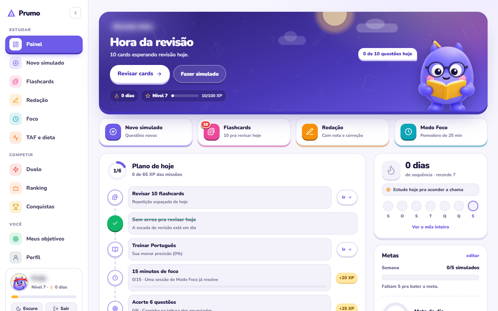
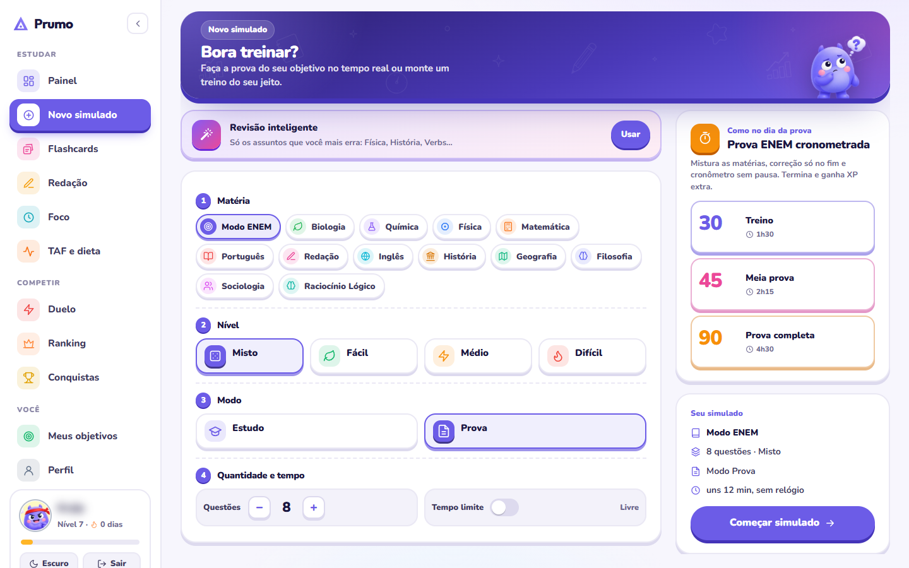
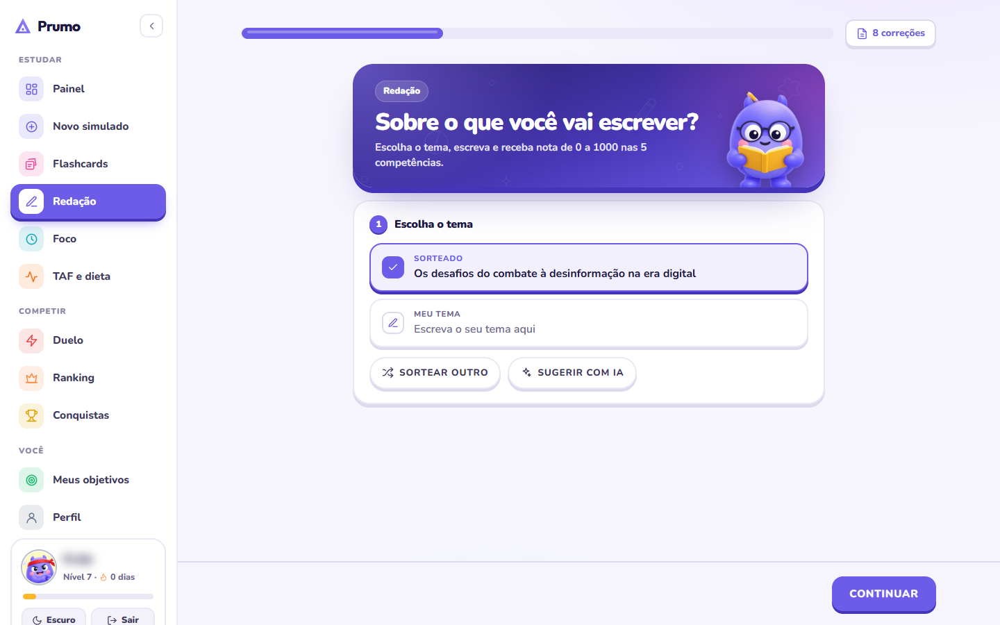
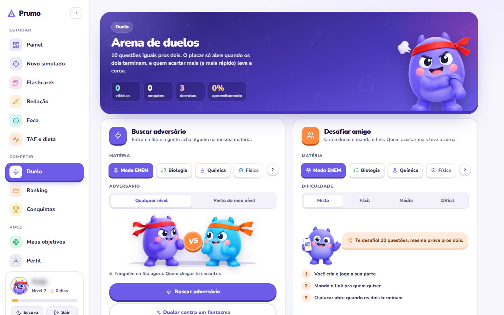

# Prumo

Plataforma de estudos com IA para ENEM e concursos.

[](https://estudeprumo.com)
[](https://estudeprumo.com)

Este repositório é um estudo de caso: documenta a arquitetura e as decisões técnicas da Prumo.
O código-fonte é proprietário e não está aqui.

Produto no ar: https://estudeprumo.com



## O problema

Quem estuda para ENEM e concurso público no Brasil esbarra em três coisas. Tem questão demais
e pouca orientação sobre o que estudar agora. Redação e discursiva levam dias para voltar
corrigidas, quando voltam. E o material costuma ser genérico: o edital de agente da PRF não é o
mesmo do cargo administrativo, mas a apostila é.

## O que a Prumo faz

Usa modelos de linguagem para montar simulados e trilhas a partir do objetivo do aluno, corrigir
redação em segundos e adaptar o conteúdo ao cargo que ele quer.

| | |
|---|---|
| Status | Em produção desde agosto de 2026, com usuários e pagamentos reais |
| Meu papel | Fundador e CEO. Trabalho no produto e no desenvolvimento (front, back e infraestrutura) |
| Time | Dois fundadores: eu e o Marcos Alan |

## Funcionalidades

- Simulados por matéria ou no formato do ENEM, com tempo de prova real e revisão focada nos assuntos em que o aluno mais erra
- Redação com tema sorteado ou sugerido pela IA e nota de 0 a 1000 nas cinco competências
- Flashcards com repetição espaçada
- Modo foco com pomodoro
- Plano de treino para o TAF de concursos policiais, com dieta
- Duelos entre alunos, ranking e conquistas
- Apps nativos para iOS e Android
- Painel interno com métricas de uso, custo de IA e desempenho

| Simulado | Redação |
|---|---|
|  |  |



## Arquitetura

```
                         ┌─────────────────────┐
     Usuários            │     Cloudflare      │   WAF, cache de borda,
  Web · iOS · Android ──▶│  DNS · CDN · Proxy  │   mitigação de DDoS,
                         └──────────┬──────────┘   TLS na borda
                                    │
                         ┌──────────▼──────────┐
                         │    VPS (Contabo)    │   Aplicação, reverse proxy,
                         │  (Linux, hardening) │   firewall, fail2ban,
                         └─────┬──────────┬────┘   renovação automática de certificado
                               │          │
                  ┌────────────▼───┐  ┌───▼──────────────┐
                  │    Supabase    │  │  Provedores LLM  │
                  │ Postgres + RLS │  │  (geração, cor-  │
                  │  Auth · Storage│  │  reção, tutoria) │
                  └────────────────┘  └───┬──────────────┘
                                          │
                                 ┌────────▼─────────┐
                                 │  Painel interno  │  Custo por requisição,
                                 │ métricas de IA   │  latência, uso por usuário
                                 └──────────────────┘
```

### Decisões técnicas

#### Row Level Security no banco, além da aplicação

Toda tabela com dado de usuário tem RLS
habilitado, com políticas que amarram cada linha ao `auth.uid()` do dono. A chave pública
(`anon`) vai no cliente e pode vazar a qualquer momento; mesmo assim, um usuário não consegue
ler os dados de outro. A autorização fica no banco, que é a última linha de defesa, e não só no
front, que é a parte mais fácil de contornar.

#### A chave privilegiada nunca sai do servidor

A `service_role` do Supabase ignora RLS. Ela só
existe no ambiente do servidor, nunca em build de cliente, em repositório ou em variável
prefixada com `PUBLIC_`.

#### Cloudflare na frente de tudo

O IP de origem da VPS não fica exposto, o que corta o ataque
direto ao servidor. A Cloudflare também faz cache de arquivos estáticos na borda, limita
requisições abusivas e termina o TLS antes da aplicação.

#### Custo de IA medido por requisição

O painel interno registra tokens, custo e latência de
cada chamada. É com esses números que decidimos qual modelo roda em qual plano.

#### Postgres gerenciado

Backup, réplica e atualização de segurança ficam com o Supabase. Com
um time de duas pessoas, operar banco próprio tiraria tempo do produto.

## Stack

| Camada | Tecnologia |
|---|---|
| Web | Next.js, TypeScript |
| Mobile | iOS nativo (Swift) e Android nativo (Kotlin) |
| Banco de dados | PostgreSQL (Supabase), com Row Level Security e funções em PL/pgSQL |
| Autenticação | Supabase Auth |
| Infraestrutura | VPS Linux na Contabo, Cloudflare (DNS, proxy, proteção contra abuso) |
| IA | APIs pagas de modelos de linguagem |
| Pagamentos | Purincash (já usamos Asaas e Stripe) |
| Testes | Vitest |

## Roadmap

- [ ] Ingestão automática de editais e notícias de concursos
- [ ] Trilhas separadas por cargo dentro do mesmo concurso
- [ ] Aulões gratuitos ao vivo

## Contato

Victor Candido, fundador e CEO · [GitHub](https://github.com/burnoutscript)

<sub>Código-fonte proprietário. Este repositório contém apenas documentação pública do projeto.</sub>
